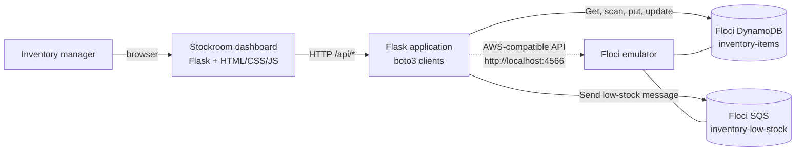
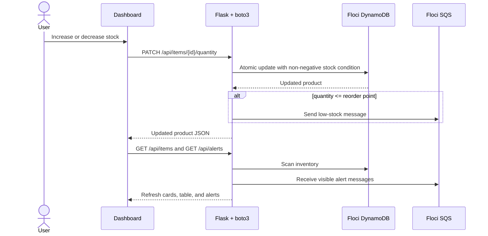
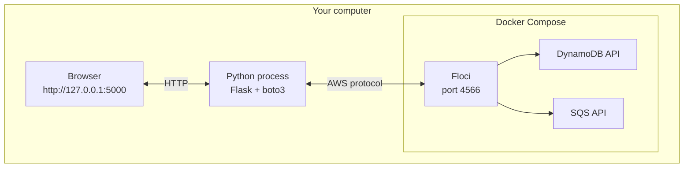

# Stockroom — local inventory management

A small inventory management system with a live dashboard, implemented in Flask and boto3. It runs against **Floci**, which emulates the AWS services locally so the experiment does not need an AWS account or cloud resources.

## Student lab

Use the step-by-step [Lab workbook](Floci_LAB.md) to run the project as a guided class activity. It includes learning goals, checkpoints, code-reading prompts, DynamoDB and SQS experiments, a small change assignment, and an instructor assessment outline. The architecture diagrams below are the system map used throughout the workbook.

## What you can do

- View product count, units on hand, estimated inventory value, and items at or below their reorder point.
- Search by product name or SKU; filter by category and stock health.
- Add products and increase or decrease quantities. Updates that would take stock below zero are rejected.
- Generate low-stock messages in SQS when a quantity update leaves a product at or below its reorder point.
- Start with five sample products, including two that are intentionally low in stock.

## Architecture

### System context and service wiring



Flask serves the dashboard and a small JSON API. The browser calls that API; only the Flask process talks to AWS-shaped services using boto3. DynamoDB is the source of truth for products. SQS is an asynchronous handoff point for reorder notifications; this demo shows queued messages in the dashboard and does not send email or run a separate consumer.

### Quantity adjustment and alert sequence



### Local deployment view



## Concepts in this experiment

- **AWS SDK endpoint override:** boto3 normally targets AWS. The app supplies Floci's local endpoint, a region, and dummy local credentials to ordinary boto3 DynamoDB and SQS clients. The data path uses standard service APIs.
- **NoSQL item model:** each product is a DynamoDB item keyed by a generated `item_id`. Product properties live together in that item. For this small demo, dashboard metrics and filters use a table scan; a larger catalog should add suitable indexes and pagination.
- **Atomic inventory changes:** the quantity adjustment is a DynamoDB update expression. A condition checks the current quantity before the update, so concurrent requests cannot silently drive stock negative.
- **Queue-based handoff:** the API writes a message to SQS when stock crosses or remains under the configured threshold after an adjustment. A real application would have a worker consume the queue and deduplicate or route alerts to a notification system.
- **Emulator boundary:** Floci provides local AWS-compatible APIs, not a production AWS account. This experiment is for development and learning; production deployment needs real AWS resources, access controls, monitoring, backups, and operational decisions.

## Prerequisites

- Python 3.10 or newer
- Docker Desktop (or Docker Engine) with Docker Compose
- A browser

## Run the experiment (Windows PowerShell)

From this directory:

```powershell
docker compose up -d
py -m venv .venv
.\.venv\Scripts\Activate.ps1
python -m pip install -r requirements.txt
python setup.py
python app.py
```

Open **http://127.0.0.1:5000**. The Floci endpoint is **http://localhost:4566**. You can also inspect Floci's resource console at **http://localhost:4566/_floci/ui** (if enabled in your Floci setup).

If PowerShell blocks virtual environment activation, use the environment's interpreter directly after creation:

```powershell
.\.venv\Scripts\python.exe -m pip install -r requirements.txt
.\.venv\Scripts\python.exe setup.py
.\.venv\Scripts\python.exe app.py
```

## Run the experiment (macOS / Linux)

```bash
docker compose up -d
python3 -m venv .venv
source .venv/bin/activate
python -m pip install -r requirements.txt
python setup.py
python app.py
```

Open **http://127.0.0.1:5000**.

## Try the inventory flow

1. On the dashboard, check the two low-stock sample rows and the reorder count.
2. Click **＋** on an item to increase its stock; **−** decreases it by one. The cards, quantity, and stock badge refresh from DynamoDB.
3. Try to remove stock from an item at zero. The API rejects an update that would make stock negative.
4. Click **−** once on **Ceramic travel mug**. Its quantity is already below its reorder point, so the change sends an SQS message that appears in Recent reorder alerts. (The initial seed data intentionally does not enqueue messages.)
5. Add a product and verify it appears in the inventory list.

You can inspect resources using the AWS CLI if installed:

```bash
aws --endpoint-url=http://localhost:4566 dynamodb list-tables
aws --endpoint-url=http://localhost:4566 dynamodb scan --table-name inventory-items
aws --endpoint-url=http://localhost:4566 sqs list-queues
```

The table and queue names can be changed using `INVENTORY_TABLE` and `LOW_STOCK_QUEUE`. `.env.example` documents the settings, but the app reads environment variables directly and does not load a `.env` file automatically. Set them in your shell before starting `setup.py` and `app.py` if you want custom names or endpoints. Defaults are ready for local Floci.

## Further practice

For a sequenced learning path with code reading and checkpoints, use the [Lab workbook](Floci_LAB.md). After the lab, students can extend the project with the following challenges.

### 1. Add a category summary

Add a dashboard card or small list that shows the number of products in each category.

- **Practice:** aggregate inventory data and render a new dashboard view.
- **Done when:** the counts update after adding a product and agree with the table filters.
- **Think about:** this app currently scans the whole table for its dashboard. How would that choice change with a very large catalog?

### 2. Make reorder thresholds editable

Add an action to change a product's reorder point from the dashboard.

- **Practice:** add a Flask API route, validate input, update one DynamoDB item, and refresh the UI.
- **Done when:** changing the threshold updates the stock badge and reorder count without changing quantity.
- **Think about:** should a threshold change itself send a low-stock message if the current quantity is already below the new threshold?

### 3. Acknowledge SQS alerts

Give each alert an **Acknowledge** button and remove the selected message from the queue when clicked.

- **Practice:** work with SQS receipt handles, message visibility, and delete semantics. The current dashboard reads messages with zero visibility timeout so they can be shown again.
- **Done when:** an acknowledged message disappears on refresh, while an unacknowledged message remains available.
- **Think about:** what happens if two dashboard users try to acknowledge the same message?

### 4. Add an inventory export

Add a button that downloads the currently displayed products as CSV.

- **Practice:** format tabular data, handle CSV escaping, and decide whether export follows the active search and filters.
- **Done when:** the downloaded file opens correctly in a spreadsheet and its rows match the chosen export scope.
- **Think about:** should the export be assembled in the browser from displayed data or generated by a Flask endpoint from DynamoDB?

### 5. Enforce unique SKUs

Prevent users from creating two products with the same SKU.

- **Practice:** model uniqueness in a key-value database and handle conflicts cleanly in the UI. A simple scan is easy to try; consider its race condition and scaling limits before treating it as production-ready.
- **Done when:** the UI explains the conflict and the existing product is left unchanged.
- **Think about:** how could a transaction or a separate SKU lookup item make the check safe when two requests arrive together?

### 6. Observe concurrent stock updates

Open the same product in two browser windows and adjust quantity from both. Then try to remove more units than are available.

- **Practice:** observe atomic DynamoDB updates and conditional writes under competing requests.
- **Done when:** all accepted adjustments are reflected, and stock never drops below zero.
- **Record:** starting quantity, accepted updates, rejected updates, and final quantity. Explain how the condition expression protects the item.

For each exercise, first note the expected behavior, make one change at a time, and use the dashboard plus the Floci console or AWS CLI to compare what the app displays with the emulator's stored data.

## Stop and reset

Stop the web app with **Ctrl+C**, then stop Floci:

```bash
docker compose down
```

The compose file uses Floci's persistent storage mode and a named Docker volume. To remove that local emulator data and start over with a clean inventory, run:

```bash
docker compose down -v
docker compose up -d
python setup.py
```

## Project files

```text
app.py                  Flask dashboard and inventory JSON API
setup.py                Creates DynamoDB/SQS resources and sample products
STUDENT_LAB.md          Guided student workbook and instructor checkpoints
templates/index.html    Dashboard markup
static/styles.css       Dashboard styling
static/app.js           Dashboard interactions and data refresh
compose.yaml            Local Floci service
requirements.txt        Python dependencies
```

## Troubleshooting

- **Dashboard reports it cannot connect:** confirm Docker is running and `docker compose ps` shows Floci healthy; then retry `python setup.py`.
- **Port 4566 is occupied:** stop the other service or update the published port in `compose.yaml` and set `AWS_ENDPOINT_URL` to match.
- **The app is using AWS instead of Floci:** check that `AWS_ENDPOINT_URL` is set to `http://localhost:4566` in the same shell that starts the app.
- **No alerts appear:** alerts are emitted when a quantity adjustment results in stock at or below the reorder point. The initial seed deliberately does not enqueue alerts.

## References

- [Floci on GitHub](https://github.com/floci-io/floci) — official image, Compose setup, endpoint, and boto3 configuration.
- [boto3 documentation](https://boto3.amazonaws.com/v1/documentation/api/latest/index.html) — Python AWS SDK reference.
